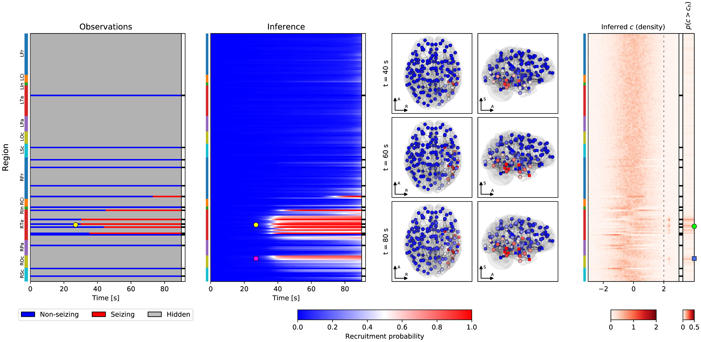

# DDMISP: Data-driven method to infer the seizure propagation patterns

This repository contains the code and data associated with the study by [Sip et al., Plos CB (2021)](#references). In the study we build a method to estimate brain activity during epileptic seizures from sparse intracranial EEG measurements. This way we can fill in the brain activity that would remain otherwise hidden. At the same time, we estimate the probability distributions of the epileptogenicity of the nodes in the brain network.

## Structure

- The directory `preproc/` contains the code to preprocess the data: prepare the structural connectomes, detect the onset times in the intracranial EEG recordings, and map them on the brain regions.
- The directory `ddmisp/` contains the code for the simulation, inference, analysis, and visualization.

Further details are described in each directory. Due to the nature of the patient data used in the study, these are available upon reasonable request from the authors.

## Environment

Python 3.7 with multiple scientific and neuroscientic libraries is necessary. Use the environment file `env.yml` to prepare the conda environment.

## References

Sip V, Hashemi M, Vattikonda AN, Woodman MM, Wang H, Scholly J, et al. (2021) Data-driven method to infer the seizure propagation patterns in an epileptic brain from intracranial electroencephalography. PLoS Comput Biol 17(2): e1008689. https://doi.org/10.1371/journal.pcbi.1008689
